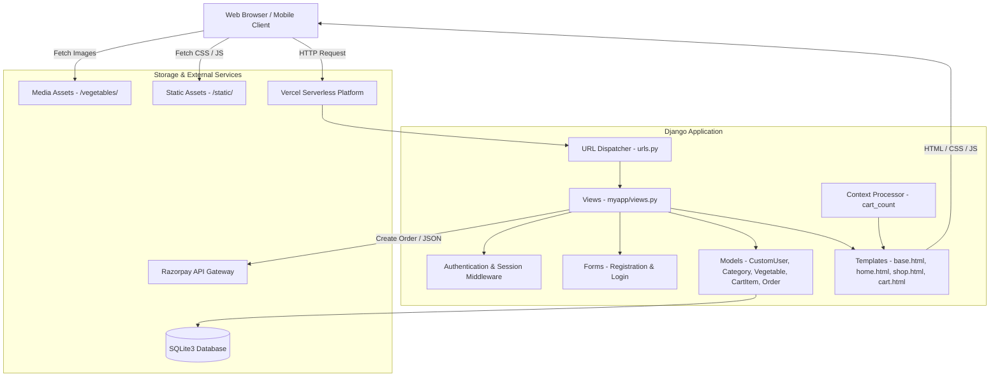
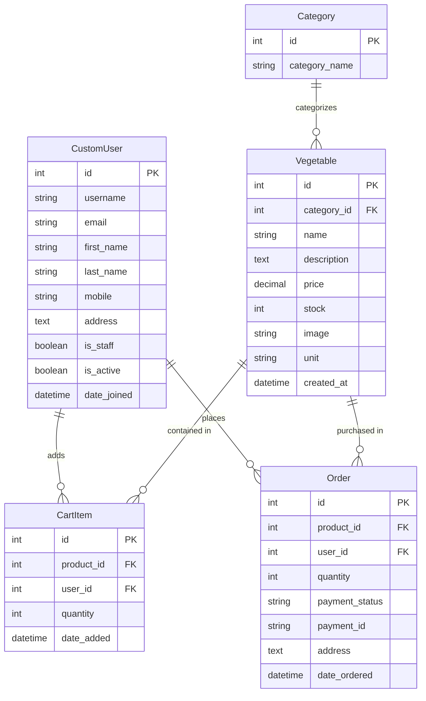

# 🥦 Vegitable Selling Site - Organic Produce E-Commerce Platform

[](https://vg-miaraj.vercel.app)
[](https://github.com/arfat87/vagitable-selling-site)
[](https://www.djangoproject.com/)
[](https://www.python.org/)
[](https://getbootstrap.com/)
[](https://razorpay.com/)

A full-stack organic vegetables and fruits e-commerce platform built with **Django**, **Python**, **SQLite**, and **Bootstrap 5** (featuring the *Fruitables* theme). The application provides an intuitive shopping workflow with customer authentication, an extensive 11-category catalog with 86 organic produce items, dynamic cart management, Razorpay payment gateway integration, customer order tracking, and a tailored Django Admin dashboard with image thumbnail previews.

---

## 🔗 Quick Links

- 🌐 **Live Website:** [https://vg-miaraj.vercel.app](https://vg-miaraj.vercel.app)
- ⚙️ **Admin Dashboard:** [https://vg-miaraj.vercel.app/admin/](https://vg-miaraj.vercel.app/admin/)
- 📂 **GitHub Repository:** [https://github.com/arfat87/vagitable-selling-site](https://github.com/arfat87/vagitable-selling-site)

---

## 📌 Table of Contents

- [Overview](#-overview)
- [Key Features](#-key-features)
- [Produce Catalog & Categories](#-produce-catalog--categories)
- [Technology Stack](#-technology-stack)
- [System Architecture](#-system-architecture)
- [Data Models & Schema](#-data-models--schema)
- [Project Directory Structure](#-project-directory-structure)
- [Installation & Local Setup](#-installation--local-setup)
- [Vercel Deployment Guide](#-vercel-deployment-guide)
- [URL Routing & Endpoints](#-url-routing--endpoints)
- [Razorpay Payment Workflow](#-razorpay-payment-workflow)
- [Configuration & Settings](#-configuration--settings)
- [Troubleshooting & FAQs](#-troubleshooting--faqs)
- [Author & Credits](#-author--credits)

---

## 📖 Overview

**Vegitable Selling Site** is designed to connect organic produce consumers directly with fresh vegetables and fruits. Shoppers can explore items across 11 categories, filter products dynamically, manage quantities in an active shopping cart, and checkout seamlessly via Razorpay. Store managers have full control over inventory, pricing, and orders through the Django admin portal.

---

## ✨ Key Features

### 👤 1. User Management & Authentication
- **Custom User Model**: Inherits from `AbstractUser` to store customer contact numbers (`mobile`) and delivery destinations (`address`).
- **Complete Auth Flow**: Styled Bootstrap forms for registration (`/registration`), customer login (`/login`), and session logout (`/logout`).
- **Personalized Header**: Dynamic navbar showing customer name, cart counter badge, and logout buttons.

### 🥦 2. Produce Catalog (11 Categories, 86 Items)
- **11 Curated Categories**: From Leafy Greens and Root Vegetables to Exotic Produce and Ready-to-Cook cuts.
- **Dynamic Category Tabs**: Front page interactive tab navigation (Bootstrap nav-pills) allowing users to switch category views without reloading.
- **Dedicated Shop Page**: Catalog view with sidebar category filtering (`/shop` and `/shop/<id>`).
- **Detailed Product Cards**: High-resolution cropped produce images, unit measurements (`Kg`, `Gram`, `Piece`, `Dozen`, `Bundle`), inventory stock, and pricing in INR (₹).

### 🛒 3. Real-Time Shopping Cart
- **Live Cart Badge Counter**: Global context processor (`cart_count`) updates the shopping bag count badge across every navbar page in real time.
- **Cart Controls**: Add items, update quantities (1–5 units), or delete items with confirmation alerts.
- **Automatic Calculations**: Dynamic subtotals and order totals calculated using `django-mathfilters`.

### 💳 4. Razorpay Payment Gateway
- **Checkout Modal**: Seamless integration with Razorpay Standard Checkout popup.
- **AJAX Order Creation**: Endpoint (`/initiate-payment/`) generates order records and securely passes transaction configuration to the client.
- **Order Persistence**: Automatically creates Order records with delivery details and clears the customer's cart upon success.

### 📦 5. Order Tracking & Administration
- **"My Orders" Dashboard**: Customer dashboard displaying ordered products, images, purchased quantities, prices, and status.
- **Customized Django Admin**:
  - Image thumbnail previews (`image_preview`) directly in the vegetable table list.
  - In-line editable stock and price for fast inventory adjustments.
  - Searchable by product name, user details, and delivery address.
  - Filters by category, creation date, and payment status.

---

## 🥕 Produce Catalog & Categories

The database includes **86 pre-configured organic produce items** across **11 categories**:

| # | Category | Count | Sample Items | Units |
|---|---|:---:|---|---|
| 1 | **Leafy Vegetables** | 8 | Spinach, Amaranth Leaves, Mustard Greens, Coriander, Mint, Fenugreek, Lettuce, Kale | Bundle, Piece |
| 2 | **Root Vegetables** | 8 | Potato, Carrot, Beetroot, Radish, Turnip, Sweet Potato, Yam, Colocasia (Taro) | Kg |
| 3 | **Bulbs & Alliums** | 6 | Onion, Garlic, Spring Onion, Leek, Shallots, Chives | Kg, Bundle, Piece |
| 4 | **Fruiting Vegetables** | 8 | Tomato, Brinjal, Capsicum, Chilli, Cucumber, Bitter Gourd, Bottle Gourd, Ridge Gourd | Kg, Gram, Piece |
| 5 | **Cabbage & Cruciferous** | 8 | Cabbage, Cauliflower, Broccoli, Brussels Sprouts, Red Cabbage, Chinese Cabbage, Kohlrabi, Romanesco | Piece, Kg |
| 6 | **Beans & Legumes** | 8 | Green Beans, French Beans, Broad Beans, Cowpeas, Cluster Beans, Lima Beans, Chickpeas, Black Gram | Kg |
| 7 | **Herbs & Sprouts** | 8 | Basil Leaves, Thyme, Rosemary, Dilli, Spring Mix, Microgreens, Methi Sprouts, Moong Sprouts | Bundle, Gram |
| 8 | **Specialty / Exotic Vegetables** | 8 | Artichoke, Asparagus, Fennel, Baby Corn, Zucchini, Pattypan Squash, Okra, Karela | Piece, Bundle, Kg |
| 9 | **Salad Vegetables** | 8 | Iceberg Lettuce, Romaine Lettuce, Cherry Tomato, Cucumber, Bell Pepper, Red Cabbage, Carrot, Radish | Piece, Kg |
| 10 | **Seasonal Specials** | 8 | Seasonal Karela, Tinda, Parwal, Seem, Jhinga, Suran, Pumpkin, Chow Chow | Kg |
| 11 | **Pre-Cut & Ready to Cook** | 8 | Mixed Veg (Cut), Chopped Onions, Chopped Tomatoes, Vegetable Mix, Frozen Peas, Sweet Corn, Baby Corn, Mixed Salad | Piece |

---

## 🛠️ Technology Stack

| Component | Technology | Description |
|---|---|---|
| **Backend** | Python 3.10 – 3.14 | Core backend language |
| **Framework** | Django 5.x / 6.x | Model-View-Template web framework |
| **Database** | SQLite3 | Default database (`db.sqlite3`) |
| **Payment Gateway** | Razorpay Python SDK | Online payment processing |
| **Image Processing** | Pillow (PIL) | Dynamic image handling and cropping |
| **Template Enhancements** | `django-mathfilters` | Template arithmetic for real-time calculations |
| **Frontend Framework** | Bootstrap 5 | Modern responsive UI components & grid |
| **Icons & Fonts** | FontAwesome 5 & Google Fonts | Crisp icons and typography |
| **Client-Side Libraries** | jQuery, Owl Carousel, Lightbox | Sliders, hero carousels, and image popups |
| **Hosting & Deployment** | Vercel | Cloud serverless deployment |

---

## 🏗️ System Architecture



---

## 🗄️ Data Models & Schema



---

## 📁 Project Directory Structure

```text
vagitable-selling-site/
│
├── manage.py                          # Django management CLI script
├── db.sqlite3                         # Local SQLite database (pre-populated)
├── requirements.txt                   # Project Python dependencies
├── README.md                          # Comprehensive documentation
├── .gitignore                         # Git ignore configuration
├── data.json                          # Content types & permissions fixture
│
├── myapp/                             # Core grocery application
│   ├── migrations/                    # Database migrations
│   │   ├── 0001_initial.py            # Initial schema: CustomUser, Category, Vegetable
│   │   └── 0002_order_cartitem.py     # Schema for Order and CartItem
│   ├── admin.py                       # Admin panel with image preview & in-line editing
│   ├── apps.py                        # App configuration
│   ├── context_processors.py          # Real-time cart badge counter
│   ├── forms.py                       # Registration and Login forms
│   ├── models.py                      # CustomUser, Category, Vegetable, CartItem, Order
│   ├── urls.py                        # App route declarations
│   └── views.py                       # Business logic for auth, catalog, cart, checkout
│
├── static/                            # Static frontend assets
│   ├── css/                           # Bootstrap & custom styling (style.css)
│   ├── js/                            # JavaScript files (main.js)
│   ├── img/                           # Banners, hero graphics, payment icons
│   └── lib/                           # Vendor plugins (owlcarousel, lightbox, easing)
│
├── templates/                         # HTML templates
│   ├── base.html                      # Base template, navbar, footer, Razorpay script
│   ├── home.html                      # Homepage with hero slider and category tabs
│   ├── shop.html                      # Catalog with sidebar category filters
│   ├── cart.html                      # Shopping cart and checkout form
│   ├── my_orders.html                 # Customer purchase history
│   ├── login.html                     # Customer authentication page
│   ├── registration.html              # Customer registration page
│   ├── contact.html                   # Contact information & support details
│   └── payment_success.html           # Payment callback landing page
│
├── vegetables/                        # Uploaded produce images
│
└── vegitable/                         # Project settings & routing package
    ├── asgi.py                        # ASGI configuration
    ├── wsgi.py                        # WSGI configuration
    ├── settings.py                    # Settings, ALLOWED_HOSTS, MEDIA_ROOT, Razorpay keys
    └── urls.py                        # Root URL routing + media serving
```

---

## 🚀 Installation & Local Setup

### Prerequisites
- **Python 3.10 – 3.14**
- `pip` package manager
- `git` version control

### 1. Clone the Repository
```bash
git clone https://github.com/arfat87/vagitable-selling-site.git
cd vagitable-selling-site
```

### 2. Set Up a Virtual Environment
- **On Windows (PowerShell):**
  ```powershell
  python -m venv venv
  .\venv\Scripts\Activate.ps1
  ```
- **On macOS / Linux:**
  ```bash
  python3 -m venv venv
  source venv/bin/activate
  ```

### 3. Install Dependencies
```bash
pip install -r requirements.txt
```

### 4. Run Migrations
```bash
python manage.py migrate
```

### 5. Create an Admin Superuser (Optional)
```bash
python manage.py createsuperuser
```

### 6. Start Development Server
```bash
python manage.py runserver
```
Open [http://127.0.0.1:8000/](http://127.0.0.1:8000/) in your web browser.

---

## ☁️ Vercel Deployment Guide

Live deployment URL: **[https://vg-miaraj.vercel.app](https://vg-miaraj.vercel.app)**.

To deploy on Vercel:
1. Ensure your `vercel.json` maps `vegitable/wsgi.py` via `@vercel/python`.
2. Add necessary environment variables in the Vercel dashboard:
   - `DEBUG=False`
   - `SECRET_KEY=<your-secret-key>`
   - `RAZORPAY_API_KEY=<your-razorpay-key>`
   - `RAZORPAY_API_SECRET=<your-razorpay-secret>`
3. To disable login requirements for external users, go to **Settings ➡️ Deployment Protection** in the Vercel project dashboard and disable **Vercel Authentication**.

---

## 🛣️ URL Routing & Endpoints

| URL Pattern | View Function | Route Name | Description |
|---|---|---|---|
| `/` | `views.home` | `home-page` | Landing page with hero banner & category tabs |
| `/shop` | `views.shop` | `shop-page` | All produce catalog with category filter sidebar |
| `/shop/<int:id>` | `views.shopCat` | `shop-cat-page` | Produce catalog filtered by category ID |
| `/registration` | `views.userReg` | `reg-page` | New customer account registration |
| `/login` | `views.userLogin` | `log-page` | Customer login |
| `/logout` | `views.userLogout` | `logout-page` | Customer logout & redirect |
| `/addtocart/<int:id>` | `views.add_to_cart` | `addtocart` | Adds product to cart or increments quantity |
| `/cart` | `views.view_cart` | `crt-page` | Cart items, subtotal calculation, checkout form |
| `/cart/update/<int:item_id>/` | `views.update_cart` | `update_cart` | Modifies item quantity (1–5 units) |
| `/cart/delete/<int:item_id>/` | `views.delete_cart_item` | `delete_cart_item` | Deletes an item from cart |
| `/initiate-payment/` | `views.initiate_payment` | `initiate_payment` | Generates Razorpay order & returns JSON config |
| `/payment-success/` | `views.payment_success` | `payment_success` | Payment success callback |
| `/my-orders` | `views.my_orders` | `my_orders` | Customer order history dashboard |
| `/contact` | `views.contact` | `cont-page` | Customer support & contact details |
| `/admin/` | `admin.site.urls` | `admin` | Django administration dashboard |

---

## 💳 Razorpay Payment Workflow

1. **Address Entry**: Customer inputs delivery address on `/cart`.
2. **Order Initiation**: Clicking **Pay Now** sends an AJAX POST request to `/initiate-payment/`.
3. **Razorpay API Call**: The server creates a payment order via Razorpay Python SDK with amount in paise.
4. **Checkout Modal**: The Razorpay Checkout popup appears with the generated `order_id`.
5. **Order Persistence**: Order records are saved in the database with payment status and address.
6. **Cart Cleared**: Shopping cart items are flushed automatically upon checkout completion.

---

## ⚙️ Configuration & Settings

Key configurations in `vegitable/settings.py`:

| Setting | Value | Description |
|---|---|---|
| `ALLOWED_HOSTS` | `['*']` | Allows connections from localhost, LAN devices, and cloud hosts |
| `AUTH_USER_MODEL` | `'myapp.CustomUser'` | Custom user model with phone and address |
| `MEDIA_URL` | `'/media/'` | Public URL prefix for produce images |
| `MEDIA_ROOT` | `BASE_DIR` | Directory where vegetable media files are stored |
| `RAZORPAY_API_KEY` | `rzp_test_...` | Razorpay Test API Key |
| `RAZORPAY_API_SECRET` | `zAh1Tu...` | Razorpay Test API Secret |
| `SECURE_CROSS_ORIGIN_OPENER_POLICY` | `"same-origin-allow-popups"` | Allows Razorpay popup window interactions |

---

## 🔧 Troubleshooting & FAQs

### 1. Python 3.14 Compatibility
- Ensure `Django>=5.0` is installed. Django 5.x fixes issues with `super()` calls in template context resolution in Python 3.14.

### 2. Media Image Display
- For local development, `urls.py` includes `static(settings.MEDIA_URL, document_root=settings.MEDIA_ROOT)`.
- For production environments with ephemeral storage (like Vercel), use cloud media storage (e.g., Cloudinary or AWS S3).

---

## 📜 Author & Credits

- **Developer:** [Sk Arfat Alli (arfat87)](https://github.com/arfat87)
- **Repository:** [https://github.com/arfat87/vagitable-selling-site](https://github.com/arfat87/vagitable-selling-site)
- **Frontend Theme:** Fruitables Template by [HTML Codex](https://htmlcodex.com)
